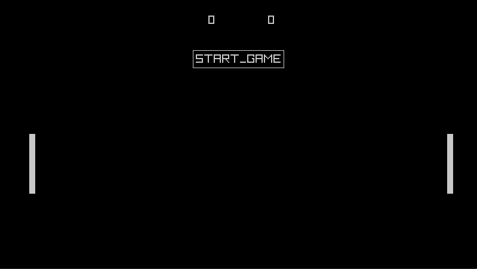

# Pong 
Simple implementation of Pong with Raylib in C. 

## Prequesites
Have Raylib installed on device, then compile from source code. Follow instructions [here](https://github.com/raysan5/raylib/tree/master#build-and-installation) for your platform. 

e.g. For linux, run the following after installing raylib
```bash
gcc main.c -lraylib -lGL -lm -lpthread -ldl -lrt -lX11 -o [output_file_name]
```

